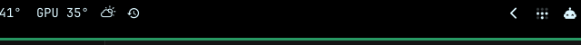

<h1 align="center">Kronos for Omarchy</h1>

<p align="center">
  Your assistant's memory in the Omarchy bar.<br>
  How much it remembers, how warm, and one click to open it.
</p>

<p align="center">
  
</p>

---

[Kronos](https://github.com/dawestheperson/kronos) keeps every conversation you
have with your AI assistant on your machine, brings the relevant ones back up on
its own, and lets you browse them by day. This plugin puts it in the bar.

## What it does

- **Hover** to see how many memories Kronos holds, how many are hot, warm and
  cold, and how many exchanges you've had today.
- **Left click** opens the Kronos app: calendar, search, memory and reader, in
  your terminal, in your theme.
- **Right click** checks Kronos and repairs anything that needs it, then tells
  you what it did in a notification.
- **Middle click** refreshes.

## Install

Kronos itself comes first. See its
[install guide](https://github.com/dawestheperson/kronos#install), then:

```bash
omarchy plugin add https://github.com/dawestheperson/omarchy-kronos --enable
```

If `kronos` isn't on your PATH, set the **Kronos program** setting to its full
path.

## Remove

```bash
omarchy plugin remove dawestheperson.kronos
```

Kronos and your memory are untouched.

## Settings

| Setting | Default | What it does |
| --- | --- | --- |
| Kronos program | `kronos` | The command, or its full path. |
| Refresh every (seconds) | 300 | How often the tooltip is updated. |

## Permissions

- **Runs:** `kronos status --json` on the refresh interval; `kronos doctor --fix`
  on right click; the Kronos app on left click.
- **Reads and writes:** nothing of its own. No network.
- **License:** [MIT](LICENSE)
